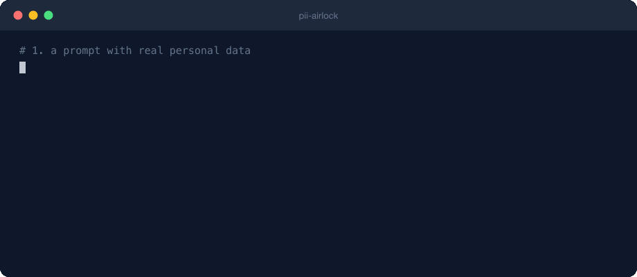

<div align="center">


# pii-airlock

**Your prompts get the placeholders. You keep the secrets.**

A local privacy layer for AI tools: swaps personal data for placeholders before requests leave your machine, then restores the originals in the reply.

[](https://github.com/matinfo/pii-airlock/actions/workflows/ci.yml)
[](https://pypi.org/project/pii-airlock/)


[](https://github.com/astral-sh/ruff)
[](LICENSE)

Works with **Claude Code · GitHub Copilot · Codex · Cursor · Aider · Gemini · any OpenAI-compatible client**

**[📖 User guide](https://matinfo.github.io/pii-airlock/) · [Quickstart](#2-minute-quickstart) · [Install](#install) · [Gateway](#universal-gateway-any-provider) · [CLI](#cli-usage) · [Copilot](#github-copilot) · [doctor](#doctor-health-checks) · [Troubleshooting](#troubleshooting) · [All agents →](AGENTS.md)**

</div>

## Why

Everything you paste into an AI tool is sent to a third party. `pii-airlock` sits between you and the provider: it spots names, emails, phones, cards, IBANs and secrets, and sends placeholders instead. Answers come back with your real values restored.

Example:

```text
John Smith (john@acme.com) → <PERSON_482913> (<EMAIL_ADDRESS_093117>)
```

Runs on **macOS, Linux, Windows** (Python ≥ 3.10). Built on [Microsoft Presidio](https://microsoft.github.io/presidio/).

<p align="center">
  
</p>

---

## What you get

| Problem | What pii-airlock gives you |
|---|---|
| You use multiple AI clients/providers | One local gateway URL for all of them |
| You need reversible anonymization | Stable placeholders + local mapping file |
| You use Claude Code tools/files | Native hooks for prompt + tool-data checks (Claude Code, Copilot) |
| You want to avoid vendor lock-in | Provider adapters: OpenAI-style, Anthropic, Gemini |

Detection happens locally. Gateway traffic is forwarded only after PII is replaced.

---

## 2-minute quickstart

```bash
pipx install pii-airlock        # or: brew install matinfo/tap/pii-airlock
cd my-project
pii-airlock init                # guard this project
```

That's it. `init` creates `.pii-airlock/` in the project, installs the hooks for
Claude Code and GitHub Copilot (once, for your user), and downloads the detection
models. From now on, in this project only, prompts and tool calls that contain
personal data are stopped before they leave your machine.

```bash
pii-airlock status              # what is guarded, by which hooks, with which policy
pii-airlock allow "Acme SA"     # never PII here (your company, products)
pii-airlock deny "Project X"    # always sensitive here (client, code name)
pii-airlock off                 # pause here (`pii-airlock on` resumes)
```

Using a chat client instead of an agent (Cursor, Codex, an SDK)? Add the
[gateway](#universal-gateway-any-provider): `pii-airlock proxy`, then point the
client's base URL at `http://127.0.0.1:8745/openai`.

---

## The project home: `.pii-airlock/`

Like `.git/` or `.codegraph/`, one folder holds everything pii-airlock knows about a project,
and its presence is the on switch:

```
my-project/.pii-airlock/
  config.yaml   policy: allow/deny lists, actions, patterns    committed, shared with the team
  .gitignore    ignores everything else                        committed
  maps/         mappings from `scrub` (real values, encrypted)  local only
  off           present while paused (`pii-airlock off`)        local only
```

- Hooks are installed once for your user and **do nothing outside a project home**, so
  unrelated repos are untouched. It is found from any subdirectory.
- A teammate who clones the repo runs `pii-airlock init` too. The shared `config.yaml` then
  applies, but only the settings that tighten protection, until they review it and run
  `pii-airlock trust` (see [Trust](#per-project-policy)).
- The token key and trust decisions stay in `~/.local/state/pii-airlock/`, never in the
  project: encrypted maps next to their key would protect nothing.
- To guard every directory instead, set `activation: always` in `~/.config/pii-airlock/config.yaml`.
- The gateway has no notion of project: it scrubs whatever is sent to it.

---

## Install

Requires Python ≥ 3.10 and [pipx](https://pipx.pypa.io/) (recommended) or pip.
Works the same on macOS, Linux and Windows.

```bash
pipx install "pii-airlock[proxy]"   # recommended (gateway included)
pii-airlock init                    # guided setup (models + env hints)
```

**Alternative: Homebrew** (macOS or Linux, instead of pipx). One command installs the
`pii-airlock` CLI, the Claude Code hooks and the gateway proxy:

```bash
brew install matinfo/tap/pii-airlock
pii-airlock download-models         # spaCy models, downloaded once
```

Homebrew puts everything in a private Python virtualenv (an isolated folder of packages),
so it cannot clash with your own Python. You never activate it: `pii-airlock` on your
`PATH` already points into it. Things to know:

- **Location:** `$(brew --prefix pii-airlock)/libexec` (find it with `brew --prefix pii-airlock`).
- **Extras:** `brew` has no flag for the optional `docx`, `pdf` and `gliner` extras. Install
  them into that venv with its own `pip` (`gliner` pulls PyTorch, a large download):

  ```bash
  "$(brew --prefix pii-airlock)/libexec/bin/python" -m pip install 'pii-airlock[docx]'
  ```

- **Upgrades reset it:** `brew upgrade` or `brew reinstall` rebuilds the venv, so re-run the
  extras and `pii-airlock download-models` afterwards. If that is a nuisance, use pipx, whose
  `pipx inject` additions survive upgrades.

Latest from source (before a release lands on PyPI):

```bash
pipx install git+https://github.com/matinfo/pii-airlock
```

Optional format support (plain text, CSV and JSON work out of the box):

```bash
pipx inject pii-airlock 'pii-airlock[docx]'   # Word .docx
pipx inject pii-airlock 'pii-airlock[pdf]'    # PDF (text extraction)
pipx inject pii-airlock 'pii-airlock[all]'    # everything
```

If you installed without gateway support and need it later:

```bash
pipx inject pii-airlock 'pii-airlock[proxy]'
```

If `download-models` reports that your interpreter has no `pip` (common in
`pipx`), run the printed `pipx inject pii-airlock "<model-wheel-url>"` commands.
The command now prints exact model wheel URLs for you.

### doctor health checks

```bash
pii-airlock doctor
```

This checks proxy dependencies, model installation, and mapping roundtrip in one command.

### Quick verification

```bash
echo "Contact John Smith at john@example.com" | pii-airlock scrub -o /tmp/scrubbed.txt
cat /tmp/scrubbed.txt   # Contact <PERSON_482913> at <EMAIL_ADDRESS_093117>
pii-airlock restore /tmp/scrubbed.txt
```

---

## Universal gateway (any provider)

The gateway is the easiest mode for non-technical users: point your AI client at
`localhost`, and pii-airlock handles scrub/restore automatically.

```
  your app ──http──▶ pii-airlock gateway ──https──▶ provider API
           ◀───────────  (restore)  ◀───────────  (scrub)
```

```bash
# already included if you installed with "pii-airlock[proxy]"
# pipx inject pii-airlock 'pii-airlock[proxy]'
pii-airlock proxy            # listens on http://127.0.0.1:8745
```

Then set the base URL in whatever client you use:

```bash
# OpenAI SDK / Codex CLI / most OpenAI-compatible tools
export OPENAI_BASE_URL=http://127.0.0.1:8745/openai

# Anthropic SDK
export ANTHROPIC_BASE_URL=http://127.0.0.1:8745/anthropic

# Google Gemini — use base path
#   https://generativelanguage.googleapis.com  ->  http://127.0.0.1:8745/gemini
```

**Why this is practical:** configure once, keep existing clients, and avoid changing prompt habits.

- **No TLS interception.** Your client talks plain HTTP to `localhost`; the proxy makes
  the real HTTPS call upstream. No certificates to install. Bind stays on `127.0.0.1` by default.
- **Auth passes through** untouched and pii-airlock never logs request headers or bodies.
  (uvicorn runs at log level `warning`, so request lines aren't logged either.)
- A **fresh in-memory mapping per request** — the gateway writes no PII to disk (only
  the stable-token key, see [Tokens](#tokens)).
- **Concurrency-safe:** detection is serialized with a lock, so the engine is shared
  safely across simultaneous requests.

**Provider coverage** — three wire formats, each with an adapter in `pii_scrub/payload.py`:

| Route | Wire format | Covers | Streaming |
|---|---|---|---|
| `/openai` | Chat Completions, Responses, Completions, Embeddings, Moderations | OpenAI, Codex, Cursor, Continue, Ollama, LiteLLM, vLLM, … | SSE ✅ |
| `/anthropic` | Messages (incl. `count_tokens`, batches) | Claude SDKs, Claude-compatible tools | SSE ✅ |
| `/gemini` | generateContent, countTokens, embedContent | Google Gemini | SSE ✅ · array-stream buffered |

Tool traffic is covered too: tool results / function outputs (where file contents
and command output live) and tool-call arguments are scrubbed on the way out;
tool-call arguments the model emits are restored on the way back.

**Fail closed.** A request body the gateway doesn't know how to scrub — an unknown
endpoint (file uploads, audio, …) or a body that isn't JSON — is refused (403/400)
instead of being forwarded. Opt specific paths out with `passthrough_paths` if you
know they carry no personal data.

Need setup for a specific client? Use **[AGENTS.md](AGENTS.md)** (Claude Code, Codex, Cursor, Continue, Aider, Gemini, GitHub Copilot).

---

## CLI usage

### Reversible scrub → restore pipe

```bash
# 1. Scrub — replaces PII with tokens, keeps the mapping (encrypted) in .pii-airlock/maps/
echo "Contacte Jean Dupont à jean@acme.fr" | pii-airlock scrub
# → Contacte <PERSON_558644> à <EMAIL_ADDRESS_094087>

# 2. Send the scrubbed text to your LLM …

# 3. Restore — swap tokens back in the model's response (use your own tokens)
echo "J'ai répondu à <PERSON_558644> via <EMAIL_ADDRESS_094087>." | pii-airlock restore
# → J'ai répondu à Jean Dupont via jean@acme.fr.
```

### Tokens

Same value, same token, so the model still sees coreference. By default tokens are
**stable**: `<PERSON_558644>` is a keyed hash (HMAC-SHA256) of the value, so it is the
same in every request, file and process — across turns, subagents, trimmed or compacted
histories — and prompt caches keep hitting. The key is created on first use in
`~/.local/state/pii-airlock/token.key` (owner-only) and never leaves your machine;
without it a token reveals nothing about its value.

- `token_rotation: day` (default) | `week` | `never` — how long a value keeps its
  token. Tokens cannot be linked across periods, so a provider cannot follow one person
  through all your conversations. Use `never` to scrub a dataset in several runs.
- `token_style: surrogate` — realistic fakes instead of tokens, keyed the same way:
  `Jean Dupont` → `Jasper Iverson`, `jean.dupont@acme.fr` → `jasper.iverson@example.com`;
  phones, cards (Luhn-valid), IBANs (valid checksum) keep their shape, IPs come from the
  documentation ranges. Text reads naturally, which some models and tools handle better
  than `<TOKENS>`. A surname alone gets the surname of the full fake, and restores alone
  too. Other entities (IDs, secrets, places) keep stable tokens. Trade-off: a fake the
  model writes in another sense (a fake first name alone, for someone else) is restored
  as well.
- `token_style: sequential` — `<PERSON_1>`, `<PERSON_2>` in reading order, per request
  or file (the previous default).
- Delete `token.key` to rotate the key immediately.

### Detect without changing text

```bash
pii-airlock detect notes.txt
# PERSON           0.85  [9:21]    'Jean Dupont'
# EMAIL_ADDRESS    0.99  [24:38]   'jean@acme.fr'
```

### File formats

```bash
pii-airlock scrub report.csv  -o report.scrubbed.csv
pii-airlock scrub data.json   -o data.scrubbed.json
pii-airlock scrub contract.docx -o contract.scrubbed.docx   # requires [docx]
pii-airlock scrub scan.pdf                                   # requires [pdf] → text on stdout
```

### Other options

```bash
pii-airlock scrub prompt.txt --no-map          # irreversible one-way scrub
pii-airlock scrub --lang fr,en                 # explicit language list
pii-airlock scrub --threshold 0.7              # raise confidence cutoff
pii-airlock scrub input.txt -o out.txt --map m.json   # mapping elsewhere (plain JSON)
pii-airlock restore out.txt --map m.json
```

Mappings go to the project's `.pii-airlock/maps/` (outside a project:
`~/.local/state/pii-airlock/maps/`), encrypted, never next to your file. `restore` tries them
all, so no `--map` is needed.

---

## Claude Code hooks

`pii-airlock init` installs them in `~/.claude/settings.json`. Or use the plugin instead:

```
/plugin marketplace add matinfo/pii-airlock
/plugin install pii-airlock@pii-airlock
```

The plugin adds a `/pii-airlock:setup` skill; `init` sees it and skips its own hooks, so
nothing is scanned twice. The plugin cannot install the Python CLI: install it first. While
the CLI is missing, prompts and tool calls in a guarded project are blocked
(`PII_AIRLOCK_PLUGIN_FAIL_OPEN=1` lets them through). The launcher is a POSIX shell script: on
Windows use `init`.

| Leak vector | Covered by | Default action |
|---|---|---|
| PII you type in a prompt | `UserPromptSubmit` | **block**, shows a scrubbed version to send instead |
| PII in a text file Claude reads (the hook scans the file content) | `PreToolUse` (`Read`) | ask |
| PII in a shell command, file write/edit, search pattern, URL or web query | `PreToolUse` | ask |
| PII in MCP tool arguments | `PreToolUse` (`mcp__*`) | ask |
| Claude knowing the rules (placeholders, never work around a block) | `SessionStart` | rules added to the session |

The hooks **detect and block/ask** — they don't silently rewrite payloads (the hook API doesn't support in-place rewriting). For a silent, reversible rewrite, use the CLI pipe above.

- `hook_decision: deny` blocks tool calls instead of asking.
- `prompt_decision: warn` sends prompts containing PII anyway, with a warning
  (Claude Code has no "ask" for prompts: it's block or send).
- If detection can't run (e.g. missing spaCy model), the hooks **fail closed**: the
  input is treated as containing PII. Set `hook_on_error: open` to skip checks instead.
- `pii-airlock install-hook` registers them by hand: `--scope project` writes the repo's
  `.claude/settings.json` (every teammate then needs the CLI), `--event tool|prompt` picks one.

**Speed: the hook daemon.** Claude Code starts a new process for every hook call, and
loading the spaCy models costs 0.5–3 s each time. With the default `hook_daemon: auto`,
the first hook call starts a small background daemon that keeps the models loaded;
later calls answer in ~60 ms. It listens on a Unix socket (mode 0600, in a directory
only you can write to) or, on Windows, on `127.0.0.1` with a random secret kept in a file only you
can read: the hook checks the daemon knows that secret before it sends any text. It reloads your
project policy on every call, and exits after `hook_daemon_idle_minutes` (30) idle. Nothing leaves
your machine.

```bash
pii-airlock daemon status     # also shown by `pii-airlock status`
pii-airlock daemon start      # warm it up now (e.g. from your shell profile)
pii-airlock daemon stop
```

While no daemon answers, hooks analyze in-process (`hook_fallback: inprocess`). With
`hook_fallback: regex` they use patterns only, in milliseconds: emails, phones, IBANs,
cards, IPs, FR/CH IDs, secrets and your `deny_list` — **names and places are not
detected** in that mode. `hook_daemon: off` disables the daemon.

**Not covered by hooks:** the *output* of a command or tool (e.g. `cat` in Bash, Grep
matches, a fetched web page) reaches the model unchecked, as do binary files (images,
PDFs). For full coverage, route the traffic through the gateway.

---

## GitHub Copilot

`pii-airlock init` installs the hook in `~/.copilot/hooks/` when it finds Copilot. It guards
Copilot's **tool calls** (`preToolUse`: shell commands, edits, file reads, web fetches, MCP
calls) in the Copilot CLI, the cloud agent and VS Code agent mode, in guarded projects only.

- **Cloud agent:** it runs on GitHub's machines, so it needs the repo-level hook:
  `pii-airlock install-hook --target copilot` writes `.github/hooks/pii-airlock.json`.
- **Chat in VS Code:** a hook cannot block prompts, so add your own model as a *Custom Endpoint*
  that points at the gateway (config in [AGENTS.md](AGENTS.md#github-copilot)).
- **Not covered:** Copilot's default models and inline suggestions.

Written from GitHub's hook specs; not yet run against a live Copilot session.

---

## Configuration

Override chain (lowest → highest priority):

```
bundled defaults → ~/.config/pii-airlock/config.yaml (you, every project)
  → <project>/.pii-airlock/config.yaml (this project) → CLI flags
```

`allow_list`, `deny_list` and `custom_patterns` accumulate across layers (your
personal allow list + the project's); every other key is overridden.

Default config (`config.default.yaml`):

```yaml
languages: [en, fr]
models:
  en: en_core_web_lg
  fr: fr_core_news_lg
score_threshold: 0.5
entities: []          # empty = all entities Presidio recognizes, minus exclude_entities
entity_actions: {}    # per type: tokenize | redact | allow | block (see Per-project policy)
exclude_entities: [DATE_TIME, URL, NRP, US_DRIVER_LICENSE, US_BANK_NUMBER,
                   US_PASSPORT, IN_VEHICLE_REGISTRATION]  # noisy in code; [] keeps all
score_thresholds: {}  # per-entity minimum, e.g. {PERSON: 0.7}
builtin_recognizers: true  # FR/CH IDs, FR/CH phone formats, secrets (see below)
analysis_cache_size: 2048  # texts remembered per language (digest + offsets, never the text); 0 = off
activation: project        # hooks run in projects with .pii-airlock/ (always: everywhere)
hook_daemon: auto          # keep models loaded between hook calls (off: never)
hook_fallback: inprocess   # no daemon answer: load models (inprocess) or patterns only (regex)
hook_decision: ask    # tool calls: ask (surface + confirm) | deny (block)
prompt_decision: block  # prompts: block (show scrubbed version) | warn (send anyway)
hook_on_error: closed   # detection failure: closed (treat as PII) | open (skip)
hook_max_file_bytes: 2000000  # larger files read by Claude count as a detection failure
passthrough_paths: []   # gateway: path fragments whose bodies may be forwarded unscrubbed

# Advanced (proxy runtime):
mapping_backend: memory   # memory (default) | file
# mapping_dir: /var/lib/pii-airlock/maps
```

For higher-volume/self-hosted setups, `mapping_backend: file` can be useful for
debugging or operational inspection. `memory` stays the safest default for local
use because mappings are ephemeral.

Mapping files hold the real values, so the file backend **encrypts them at rest**
(AES-256-GCM, key derived from `token.key` in the state directory). A copied or
backed-up `maps/` directory is then useless without that key: keep `token.key` out of
backups, and note that losing it makes pending mappings unreadable (they only live for
one request). Plain files from older versions still load. Set `mapping_encryption: false`
to write readable JSON for debugging; this is ignored in an untrusted project's config.
`pii-airlock scrub` encrypts its mappings the same way, unless you pass `--map` (plain JSON
where you said).

### Built-in recognizers

On top of Presidio, pii-airlock ships checksum-validated recognizers that work in
every language and need no model:

| Entity | What | Validation |
|---|---|---|
| `FR_NIR` | French social security number | mod-97 key (incl. Corsica 2A/2B) |
| `CH_AHV` | Swiss AHV/AVS number `756.xxxx.xxxx.xx` | EAN-13 check digit |
| `FR_SIRET` / `FR_SIREN` | French business IDs (sole traders are people) | Luhn; SIREN needs the keyword |
| `DE_TAX_ID` | German tax ID (Steuer-IdNr.), needs the keyword (`Steuer-ID`, `IdNr`) | ISO 7064 MOD 11,10 |
| `DE_TAX_NUMBER` | German `Steuernummer` (`21/815/08150`), needs the keyword | format |
| `IT_VAT_CODE` | Italian Partita IVA, with the `IT` prefix or a `P.IVA` keyword | Luhn |
| `PHONE_NUMBER` | International `+CC …` in any language; FR/CH/DE/IT national formats (`06 12 34 56 78`, `079 123 45 67`, `030 12345678`, `333 1234567`) | format |
| `SECRET` | AWS/GitHub/Slack/OpenAI/Anthropic/Google/Stripe keys, JWTs, private keys, URL passwords, `password=…` values | format |

Exclude any of them with `exclude_entities`, or all with `builtin_recognizers: false`.

### Per-project policy

The project policy is `.pii-airlock/config.yaml`, a plain YAML file that takes any setting
above. Edit it by hand or from the CLI:

```bash
pii-airlock allow "Acme SA"                        # never PII here (your company, products)
pii-airlock deny "Project Phoenix" --as CODENAME   # always sensitive here
pii-airlock allow "Jane Roe" --scope user          # personal, all projects
pii-airlock status                                 # effective policy
```

```yaml
allow_list: [Acme SA]
deny_list:
  CODENAME: [Project Phoenix]
custom_patterns:
  - {entity: CONTRACT_ID, regex: 'CT-\d{6}'}
```

Hooks apply the policy of the project Claude Code is working in. Every detection
message shows the one-command fix for a false positive.

**Trust.** The policy comes with the repo, and a policy can loosen protection
(`allow_list`, `hook_on_error: open`, `entity_actions: {PERSON: allow}`...). So for a
project you have not trusted, only settings that **tighten** apply (deny-list terms,
custom patterns, `block` / `redact`, `deny` / `block` / `closed` decisions). A policy
`init` creates, and your own `allow`, `deny` and `action` edits, are trusted; after a
`git pull` that changes it, review it and run `pii-airlock trust`. `pii-airlock status`
says what is being ignored. User-level config is always trusted.

#### What happens to each entity type

By default every detected entity is **tokenized** (reversible). Choose per type:

| Action | Effect |
|---|---|
| `tokenize` | token or fake, restored in the response (default) |
| `redact` | irreversible `[IBAN_CODE]`; the value is never kept, not even in a mapping file |
| `allow` | left as is and not flagged (what `exclude_entities` does for its list) |
| `block` | the gateway answers **403** and sends nothing, `scrub` writes nothing, hooks **deny** (even with `hook_decision: ask`) and block prompts (even with `prompt_decision: warn`); messages name the type and count, never the value |

```bash
pii-airlock action IBAN_CODE redact          # this project
pii-airlock action CREDIT_CARD block --scope user
```

```yaml
entity_actions:
  IBAN_CODE: redact
  SECRET: block        # API keys and passwords never leave the machine
  LOCATION: allow
```

Layers accumulate (user config + project policy); an explicit action beats
`exclude_entities`. Names found elsewhere in the text keep following their person:
with `EMAIL_ADDRESS: allow`, `marie@acme.fr` stays but a bare `marie` that
matches a detected "Marie Dubois" is still tokenized.

### Adding a language

```bash
python -m spacy download de_core_news_lg
```

```yaml
# .pii-airlock/config.yaml (or ~/.config/pii-airlock/config.yaml)
languages: [en, fr, de]
models:
  de: de_core_news_lg
```

### One multilingual model (GLiNER)

Instead of a spaCy model per language, [GLiNER](https://github.com/urchade/GLiNER)
(`urchade/gliner_multi_pii-v1`) finds people, organizations and places in any language
with one model. Emails, phones, IDs and secrets are still found by patterns.

```bash
pipx inject pii-airlock 'pii-airlock[gliner]'   # or: pip install 'pii-airlock[gliner]' (PyTorch)
pii-airlock download-models                     # with ner_backend: gliner, fetches the ~1.1 GB model
```

```yaml
ner_backend: gliner
```

On the bundled EN+FR eval corpus (`python -m tests.eval.run_eval --backend gliner`):

| | spaCy `_sm` models | GLiNER |
|---|---|---|
| PERSON recall / precision | 0.96 / 0.68 | 1.00 / 0.95 |
| All entities, precision | 0.67 | 0.98 |
| Time per message (CPU) | ~6 ms | ~40 ms |

Fewer false positives means fewer needless hook prompts. Long texts are scanned in
overlapping windows (GLiNER itself truncates past a few hundred words). Organizations
and places must be capitalized to count, which drops common nouns GLiNER tags ("la
société", "client"); names are kept in any case. With the hook daemon the model is
loaded once.

---

## Guarantees & limitations

**What pii-airlock guarantees**

- **Reversibility is exact.** Any value the engine tokenized is restored byte-for-byte
  via the mapping. `restore(scrub(text))` round-trips for tokenized spans.
- **Determinism.** The same value gets the same token within a mapping (and, with stable
  tokens, across requests), so coreference is preserved for the model.
- **Found once, scrubbed everywhere.** A value detected anywhere in a request or file
  — and the parts of a person's name — is scrubbed at every other mention, earlier ones
  included, even where the model missed it.
- **Tokens are opaque & safe.** Restored values are re-inserted through proper JSON
  encoding; values containing quotes, newlines or `<…>` won't corrupt payloads.
- **Local-only detection.** Detection never makes a network call. Only the gateway
  forwards (already-scrubbed) traffic onward.

**What it does *not* guarantee — read this**

- **Detection is best-effort, not complete.** Presidio + spaCy are statistical; they
  miss and mis-tag entities (more so with `_sm` models, or for phone numbers with odd
  spacing). pii-airlock reduces exposure — it is **not** a guarantee that every piece of
  PII is removed. Review sensitive material; raise `score_threshold` or add custom
  recognizers as needed.
- **Gateway scope.** Text in generation, embedding and token-count requests is scrubbed,
  including tool results and tool-call arguments. Images, audio and file attachments
  inside a request are forwarded as-is (not inspected). Other endpoints with a body are
  refused unless listed in `passthrough_paths`. Anthropic `thinking` blocks are signed,
  so they are neither scrubbed nor restored.
- **All configured languages are analyzed** for every text and the results merged, so
  mixed EN/FR text is covered — at the cost of one NER pass per language.
- **Gemini array streaming** (without `alt=sse`) is buffered, then restored as one
  response rather than streamed live.
- **`.docx`** scrubbing rewrites changed paragraphs into a single run, so inline
  formatting within those paragraphs is not preserved. **PDF** is extract-only → scrubbed
  text out (no PDF re-render).

---

## Platform support

Tested in CI on **Linux, macOS and Windows** (Python 3.10–3.14 on Linux; 3.12–3.13 on
macOS/Windows). One platform nuance:

- Mapping files are created with mode **`0600` on POSIX** (macOS/Linux). **On Windows**
  `chmod` is a no-op; the file inherits your account's default ACLs — typically already
  user-private in a home directory. Treat mapping files as secrets regardless (below).

---

## Troubleshooting

Run this first for a quick diagnosis:

```bash
pii-airlock doctor
```

**`.venv/bin/pytest: bad interpreter .../pii-scrub/...`**

Your venv points to an old repo path. Recreate it:

```bash
rm -rf .venv
python3 -m venv .venv
.venv/bin/python -m pip install -U pip
.venv/bin/python -m pip install -e '.[dev]'
```

**`No module named spacy` when running `python -m spacy ...`**

You are likely using system Python instead of the `pii-airlock` environment.
Use:

```bash
pii-airlock download-models
```

**`download-models` says this interpreter has no pip**

This is normal in many `pipx` environments. Run the exact `pipx inject` command
printed by `download-models` for each model wheel URL.

**`pii-airlock proxy` fails with missing `httpx` / `starlette` / `uvicorn`**

Install gateway dependencies:

```bash
pipx inject pii-airlock 'pii-airlock[proxy]'
```

**`OSError: [E050] Can't find model ...` after download**

Install the model wheel directly into the same environment where `pii-airlock`
runs (the command prints the exact wheel URL in this case).

---

## ⚠ Security: mapping files hold real PII

A mapping file pairs every token with the **original personal data**.

- `scrub` writes them to `.pii-airlock/maps/` (owner-only folder), **encrypted**
  (AES-256-GCM, key derived from `token.key` in `~/.local/state/pii-airlock/`). A copied,
  synced or backed-up project folder is useless without that key: keep `token.key` out of
  backups and never in the repo. Losing it makes the maps unreadable.
- `.pii-airlock/.gitignore` keeps `maps/` out of git; only `config.yaml` is committed.
- `--map PATH` writes plain JSON where you say (add `--encrypt-map` to encrypt it): never
  commit such files. The repo `.gitignore` here excludes `*.pii-map.json` and `*.pii-map.*`.
- Delete maps you no longer need. Use `--no-map` when reversibility isn't required.
- The gateway keeps its mapping in memory only and discards it after each response.

---

## Development

```bash
git clone https://github.com/matinfo/pii-airlock
cd pii-airlock
pip install -e ".[dev]"
ruff check .
pytest -q
```

Unit tests stub out Presidio/spaCy and run entirely offline. Detection quality is measured separately on a labeled EN+FR+DE+IT corpus (fake data) with the real small models: `python -m tests.eval.run_eval -v` prints per-entity recall/precision, `--gate` fails below `tests/eval/thresholds.json` (also `pytest -m eval`). Add a case to `tests/eval/corpus.jsonl` when you fix a miss.

 For a live end-to-end check, run `pii-airlock download-models` first, then:

```bash
echo "Call John Smith at john@example.com" | pii-airlock scrub
```

---

## Community

- 🧩 **[Integrate with your agent](AGENTS.md)** — Claude Code, GitHub Copilot, Cursor, Codex, Gemini, Continue, Aider, …
- ❓ **Need help?** Open a **[bug report](https://github.com/matinfo/pii-airlock/issues/new/choose)** with:
  - `pii-airlock --version`
  - your install method (`pipx` or `pip`)
  - the exact command and full error output
- 🤝 **[Contributing](CONTRIBUTING.md)** — adding a language or a provider adapter is a great first PR
- 🔒 **[Security policy](SECURITY.md)** — responsible disclosure + the honest threat model
- 📜 **[Changelog](CHANGELOG.md)** · **[Code of Conduct](CODE_OF_CONDUCT.md)**

If pii-airlock helps you keep PII out of your AI tools, a ⭐ helps others find it.

---

## License

[MIT](LICENSE) © pii-airlock contributors
